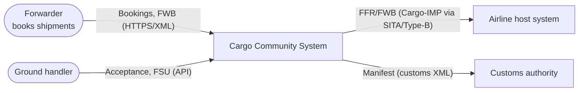
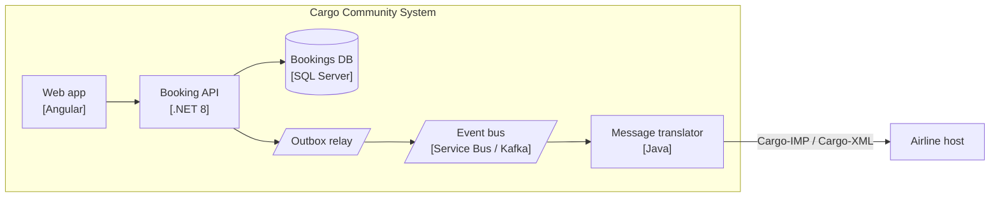
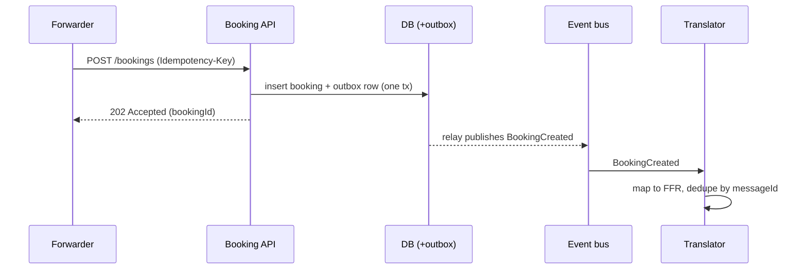

# Mermaid Diagram Guidance

Use plain `flowchart` for C4-style diagrams (renders everywhere). Mermaid's experimental `C4Context` syntax is fine only if the user's renderer supports it.

## Conventions
| Element | Style |
|---|---|
| Person / external party | `(["Name role"])` |
| Our system / container | `["Name [Tech] purpose"]` |
| Database | `[("Name [SQL Server]")]` |
| Queue / topic | `[/"Name [Service Bus]"/]` |
| Boundary | `subgraph` with a title |
| Arrow | Label with intent + protocol: `-->|"Sends FWB (Cargo-XML/HTTPS)"|` |
Keep ≤ 12 boxes per diagram; split otherwise.

## C4 L1 context example

## C4 L2 container example

## Sequence for a key flow

## Checklist
- Every box: name + technology; every arrow: what + protocol
- Sync vs async visually distinct (label "async" or use queue nodes)
- Trust boundaries shown with `subgraph`
- Diagram matches the text (same names)
