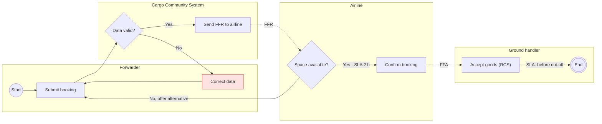

# Business Process Flows (BPMN-lite in Mermaid)

## Elements
| BPMN idea | How to draw in Mermaid `flowchart` | Rule |
|---|---|---|
| Pool / lane (role or system) | `subgraph lane_id["Forwarder"]` | One lane per actor; system lanes allowed |
| Start / end event | `start(("Start"))`, `done((("End")))` | Exactly one start; every path reaches an end |
| Task | `t1["Submit booking"]` | Verb + object; one actor |
| Exclusive gateway (XOR) | `g1{"Space available?"}` | Question; label every outgoing edge (Yes/No) |
| Parallel gateway (AND) | `p1{{"Fork"}}` … `p2{{"Join"}}` | Every fork has a matching join |
| Timer / SLA | Edge label `-->|"SLA 2 h"|` or task text `⏱ 2 h` | Every human task has an SLA |
| Message to other party | `-.->|"FWB"|` dotted edge | Dotted = async message |
| Exception / error path | `-->|"Rejected"|` into a lane step, style `:::exc` | Every gateway "No" goes somewhere |

## Steps
1. Scope: trigger (what starts it), outcome (what "done" means), actors.
2. Write the happy path as a numbered list of tasks with actor.
3. Add decisions (gateways) and exception paths: rejected, timeout, missing data, system down.
4. Add SLAs per task and end-to-end, and the escalation when breached.
5. Draw in Mermaid; then fill the step table below.

## Step table (always include)
| # | Step | Actor/Lane | Input | Output | SLA | Exception → handling |
|---|---|---|---|---|---|---|

## Example: export booking to acceptance

## Common exception set for logistics flows
| Exception | Typical handling |
|---|---|
| Invalid / incomplete message | Reject with reason code; notify sender; park for correction |
| Partner system timeout | Retry with backoff; after N tries route to manual queue |
| Duplicate submission | Idempotency key; return original result |
| SLA breach (e.g., no FFA in 2 h) | Escalate to ops desk; alert |
| Regulatory hold (customs, DG, security) | Hold state; notify; wait for release event |
| Cut-off missed | Rebook to next flight; notify customer |
