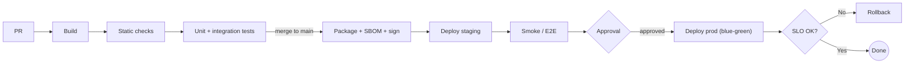

# CI/CD Pipeline Workflows

## Standard stages
| Stage | Runs on | Gate to pass | Typical tools |
|---|---|---|---|
| 1 Build | Every PR + main | Compiles; lockfile consistent | dotnet / maven / gradle / npm / uv |
| 2 Static checks | Every PR | Lint, format, SAST, secret scan, dependency CVEs (fail on High/Critical) | CodeQL, Semgrep, gitleaks, Dependabot/Renovate, OWASP Dependency-Check |
| 3 Unit tests | Every PR | All pass; coverage not below baseline | xUnit/NUnit, JUnit, pytest, Jest/Vitest |
| 4 Integration / contract tests | Every PR (or main) | Pass against ephemeral DB/broker | Testcontainers, Pact |
| 5 Package | main | Versioned, immutable artifact/image; SBOM; signed | Docker, OCI registry, Syft, Cosign |
| 6 Deploy staging | main | Auto | Helm, Bicep/Terraform, slots |
| 7 E2E / smoke | After staging deploy | Critical journeys pass | Playwright |
| 8 Approval | Before prod | Environment reviewers; change window if required | GitHub environments, ADO approvals & checks |
| 9 Deploy prod | After approval | Blue-green / canary; health + SLO checks | Slots, Argo Rollouts, Flagger |
| 10 Verify & rollback | After prod | Error rate/latency within SLO for N min, else auto-rollback | Monitors, alerts |

## Principles
- Build once, deploy the same artifact everywhere; config per environment.
- DB migrations: expand → deploy → contract; never breaking in one release.
- Secrets via OIDC federation / vault, not long-lived CI secrets.
- Pin actions/tasks/plugins (SHA for third-party); least-privilege tokens (`permissions:`).
- Fast feedback: PR pipeline ≤ 10 min; parallelize tests; cache dependencies.
- Rollback path is tested, not theoretical: redeploy previous artifact or swap slot; feature flags for risky changes.

## Platform mapping
| Concept | GitHub Actions | Azure DevOps (YAML) | Jenkins (Declarative) |
|---|---|---|---|
| Pipeline file | `.github/workflows/*.yml` | `azure-pipelines.yml` | `Jenkinsfile` |
| Stage / job | `jobs.<id>` with `needs:` | `stages:` → `jobs:` | `stages { stage('x') {...} }` |
| Environment + approval | `environment:` + required reviewers | `deployment` job + Environment approvals & checks | `input` step / plugin |
| Secrets | Secrets, OIDC (`id-token: write`) | Variable groups, Key Vault, service connections (workload identity) | Credentials plugin |
| Artifacts | `actions/upload-artifact` | `PublishPipelineArtifact` | `archiveArtifacts` / Nexus / Artifactory |
| Conditions | `if:` | `condition:` | `when {}` |
| Reusable pieces | Reusable workflows, composite actions | Templates (`extends`, `template:`) | Shared libraries |
| Rollback | Re-run deploy with previous version input | Redeploy previous run / `deployment` strategy `on: failure` hooks | Parameterized build with version |

## Template
`templates/github-actions-template.yml`: build + test + package on PR/main, staging auto-deploy with smoke tests, production behind environment approval with blue-green and auto-rollback step, manual rollback via `workflow_dispatch`. Replace every `TODO`.

## Diagram

