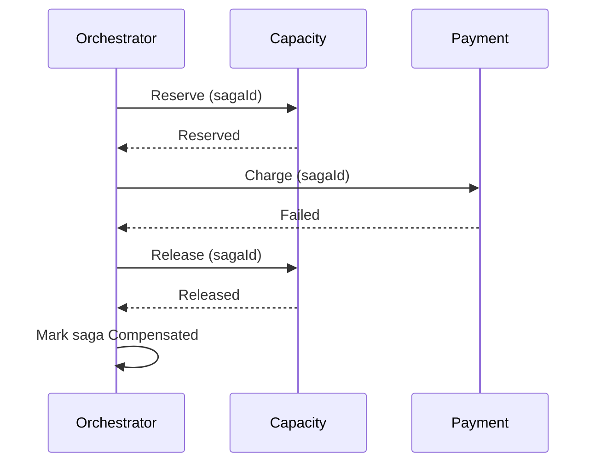

# Orchestration vs Choreography, Retries, Idempotency, Compensation

## Choosing
| Factor | Orchestration (central coordinator) | Choreography (services react to events) |
|---|---|---|
| Steps | > 3-4 steps, branching, timers, human tasks | 2-3 steps, simple fan-out |
| Visibility | One place shows state of each instance | State spread across services; needs tracing |
| Coupling | Orchestrator knows all participants | Loose; producers don't know consumers |
| Change | Change flow in one place | Change may touch many services |
| Failure/compensation | Explicit, easy to reason about | Each service must handle its own compensation |
| Risk | Orchestrator becomes a bottleneck/god service | Hidden cyclic event chains, hard debugging |
| Tools | Temporal, Camunda 8, AWS Step Functions, Azure Durable Functions / Logic Apps | Kafka, Azure Service Bus topics, RabbitMQ, EventBridge |

Default: **orchestrate** business transactions with compensation or SLAs (booking → capacity → payment → confirmation); **choreograph** notifications and fan-out (status updates to all subscribed parties).

## Retries
| Rule | Value / practice |
|---|---|
| Retry only transient errors | Timeouts, 408/429/5xx, broker unavailable; never 400/401/403/422 |
| Backoff | Exponential with full jitter: `sleep = random(0, min(cap, base × 2^attempt))` |
| Limits | 3-5 attempts in-process; longer schedules via delayed/scheduled messages |
| Respect | `Retry-After` headers; partner rate limits |
| Layering | Retry at one layer only; timeout < retry budget < caller timeout |
| After final failure | Dead-letter queue + alert + replay tool |

## Idempotency
| Where | Technique |
|---|---|
| API (POST) | `Idempotency-Key` header stored with response for 24-72 h |
| Consumer | Processed-messages table keyed by messageId (or business key: AWB + event code + event time), inserted in the same transaction as the effect |
| DB writes | Upsert by natural key; unique constraints as the last line of defence |
| State machine | Ignore events that do not change state; reject stale by sequence/timestamp |
| Outbound | Pass idempotency keys to partners that support them |

## Compensation (Saga)
| Step | Action | Compensation | Retriable? |
|---|---|---|---|
| 1 | Reserve capacity on flight | Release capacity | Yes |
| 2 | Charge / credit check | Refund / release credit | Yes |
| 3 | Confirm booking to forwarder (pivot: point of no return) | Send cancellation notice | n/a |
| 4 | Notify ground handler | None needed (retry until success) | Yes |

Rules: compensations are idempotent and retriable; order steps so the least reversible step (pivot) is last before only-retriable steps; record saga state per instance; alert humans when compensation itself fails.

## Sequence template

