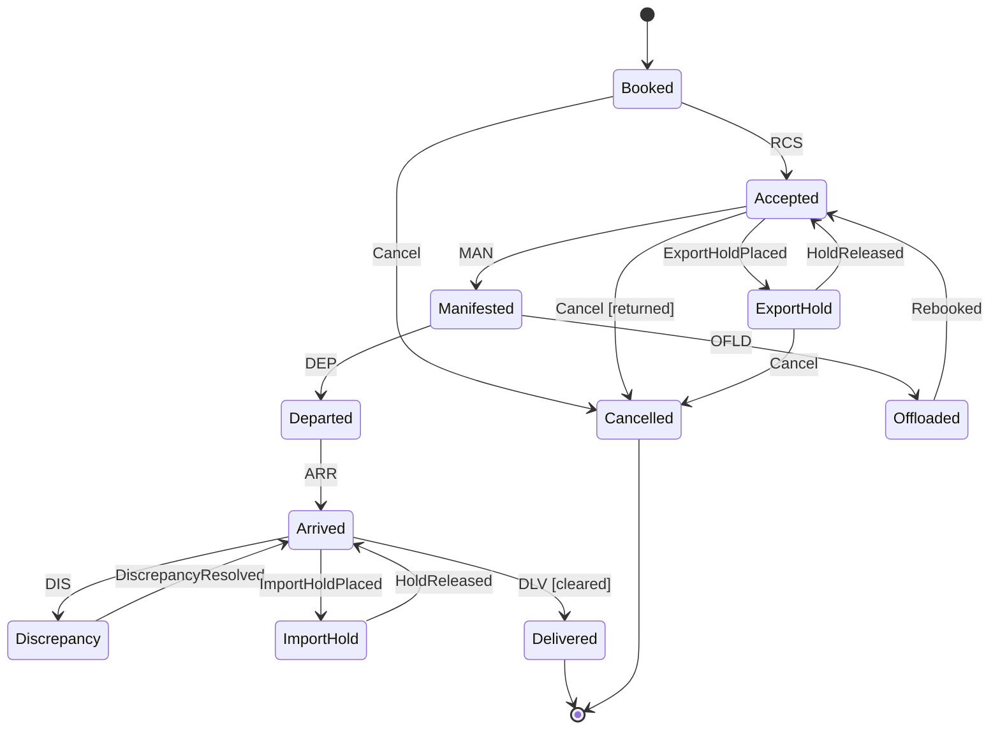

# State Machines

## Method
1. Name the entity and its key (AWB, booking, ULD, customs declaration).
2. List **states** as facts that are true ("Manifested"), not activities ("Manifesting").
3. List **events** as things that happened (past tense or message codes: RCS, MAN, DEP).
4. Fill the transition table; add **guards** where one event can lead to different states.
5. Add exception states and how each returns to the happy path or ends.
6. Mark initial and terminal states; add SLA (max time in state) for timers/alerts.
7. Define handling for invalid, duplicate and out-of-order events.
8. Run `scripts/validate_state_machine.py`; fix every ERROR.
9. Draw `stateDiagram-v2` from the validated table (table is the source of truth).

## Design rules
| Rule | Why |
|---|---|
| One owner service writes the state | Avoids conflicting updates |
| Persist state + version; update with optimistic concurrency | Concurrent events on the same AWB |
| Store every event in a history table, even if it does not change state | Audit, replays, late events |
| Transitions are idempotent: same event twice = no second change | At-least-once messaging |
| Out-of-order: compare event timestamp/sequence; never move backwards on a stale event | FSU messages arrive late from partners |
| Exception states have an SLA and an owner | Nobody notices stuck shipments otherwise |
| Prefer separate hold states (ExportHold, ImportHold) over one generic "OnHold" | Generic hold needs "history" to know where to return; non-deterministic |
| Keep ≤ ~12 states per machine; use sub-machines (per leg, per piece) beyond that | Readability |

## Worked example: AWB lifecycle (single leg)
Initial: Booked
Terminal: Delivered, Cancelled

| From | Event | Guard | To | Action |
|---|---|---|---|---|
| Booked | RCS (received from shipper) | pieces/weight within tolerance | Accepted | Publish AwbAccepted |
| Booked | Cancel | - | Cancelled | Release capacity |
| Accepted | MAN (manifested on flight) | - | Manifested | Link to flight/ULD |
| Accepted | ExportHoldPlaced | customs/DG/security hold | ExportHold | Notify forwarder |
| Accepted | Cancel | goods returned to shipper | Cancelled | Release capacity |
| ExportHold | HoldReleased | - | Accepted | Notify forwarder |
| ExportHold | Cancel | shipment withdrawn | Cancelled | - |
| Manifested | DEP (flight departed) | - | Departed | Send FSU/DEP to parties |
| Manifested | OFLD (offloaded) | - | Offloaded | Alert; rebook |
| Offloaded | Rebooked | - | Accepted | Await next MAN |
| Departed | ARR (flight arrived) | - | Arrived | Start import SLA timer |
| Arrived | DIS (discrepancy) | pieces missing/damaged | Discrepancy | Open irregularity case |
| Discrepancy | DiscrepancyResolved | - | Arrived | Close case |
| Arrived | ImportHoldPlaced | customs hold | ImportHold | Notify consignee/broker |
| ImportHold | HoldReleased | - | Arrived | - |
| Arrived | DLV (delivered) | customs cleared | Delivered | Stop timers; close AWB |

Multi-leg shipments: model legs as a sub-machine per segment (Manifested → Departed → Arrived per leg) and derive the AWB state from the last leg; or add a transit state (`Arrived --RCF at transit--> Accepted`).

## Implementation options
| Option | Use when | Not when |
|---|---|---|
| Transition table in DB/config + generic engine | Many entity types, rules change often | Few states, rarely changes |
| Code (enum + switch / State pattern) | Small, stable machine | Business users must edit it |
| Library (Stateless for .NET, Spring State Machine, python-statemachine, XState for UI) | Need guards, hierarchy, visualization | Trivial machine |
| Workflow engine (Temporal, Camunda 8, AWS Step Functions, Azure Durable Functions) | Long-running with timers, human tasks, compensation | Pure status tracking with no orchestration |
