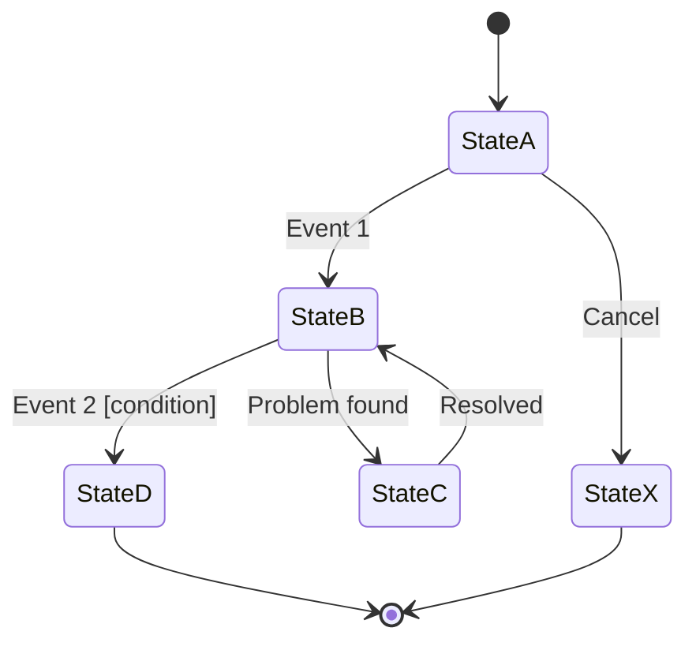

# State Machine: <Entity> lifecycle

| Field | Value |
|---|---|
| Entity / key | <e.g., AWB, identified by AWB number> |
| Owner (system of record) | <service that owns state changes> |
| Source of events | <e.g., FSU messages, UI actions, timers> |
| Version | <v1, YYYY-MM-DD> |

Initial: <State A>
Terminal: <State D>, <State X>

## States
| State | Meaning | Type | Max time in state (SLA) | On entry |
|---|---|---|---|---|
| <State A> | <what is true in this state> | Initial | <e.g., 24 h> | <action, event published> |
| <State B> | <…> | Normal | <…> | <…> |
| <State C> | <…> | Exception | <…> | <alert / notify> |
| <State D> | <…> | Terminal | n/a | <…> |
| <State X> | <…> | Terminal (cancel) | n/a | <…> |

## Transitions
| From | Event | Guard | To | Action | Idempotency key |
|---|---|---|---|---|---|
| <State A> | <Event 1> | - | <State B> | <side effect> | <e.g., messageId> |
| <State A> | <Cancel> | - | <State X> | <…> | <…> |
| <State B> | <Event 2> | <condition> | <State D> | <…> | <…> |
| <State B> | <Problem found> | - | <State C> | <…> | <…> |
| <State C> | <Resolved> | - | <State B> | <…> | <…> |

## Rules for unlisted events
- Event not valid in current state: <reject + log / park for review / ignore duplicate>
- Out-of-order events (timestamp older than current state): <store in history, do not move state>

## Diagram

Validate: `python3 scripts/validate_state_machine.py <this-file>.md`
